# CHAMA: system screenshots

The web app for running a chama: contributions, M-Pesa payments, rules, members, statements and the audit log.  
Screenshots taken on 10 November 2026 from the running system.  

The same screenshots are in the Word document [CHAMA_Screenshots.docx](CHAMA_Screenshots.docx).

## About this document

Every figure was taken from the running web app at 1440 by 900 pixels, against the demonstration data that python manage.py seed_demo creates. Each figure is numbered and has a short description of what the page is for.

The screenshots are taken while signed in as Musa Otieno, who belongs to two chamas with different roles: he is treasurer of Umoja Savings Group and chairperson of Tujenge Investment Club. What a member sees depends on the role they hold in that chama, so the two sections show the same app from two sides.

No Daraja key was set, so M-Pesa runs in simulated mode: the app shows the prompt a phone would show, and the answer goes through the same callback code as a real payment. The receipt numbers starting with SIM come from this simulation, and references starting with DEMO were created by the demonstration data. None of them are real transactions.

### List of figures

1. Log in
2. Create an account
3. Your chamas
4. Create a chama
5. Overview
6. Contributions
7. M-Pesa prompt (simulated)
8. Contribution received
9. Statements
10. Overview
11. Members
12. Rules and constitution
13. Audit log
14. Settings

## 1. Signing in

Anyone can create an account. A chama is private until its chairperson makes it public, so a new member joins by invitation or by asking to join.

### Log in

Members log in with their email address or their phone number. Repeated failed attempts are rate limited.

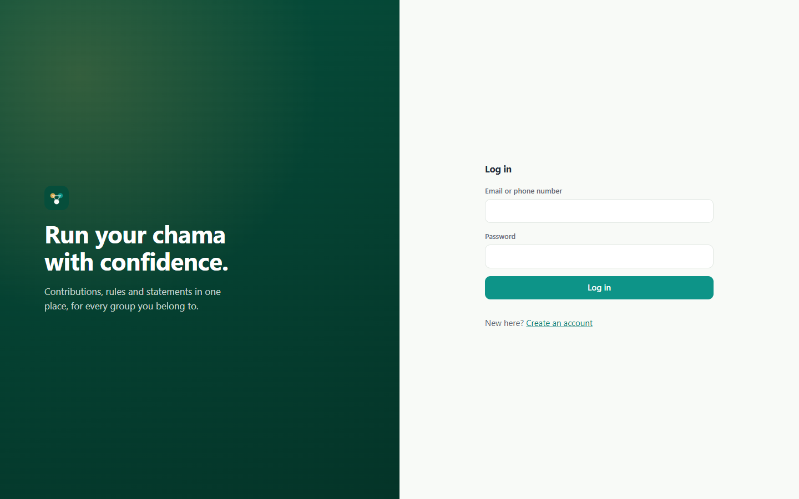

*Figure 1: Log in*

### Create an account

A new user gives their name, email and phone number. The phone number is the one M-Pesa prompts are sent to. Passwords must be at least 8 characters and are checked against a list of common passwords.

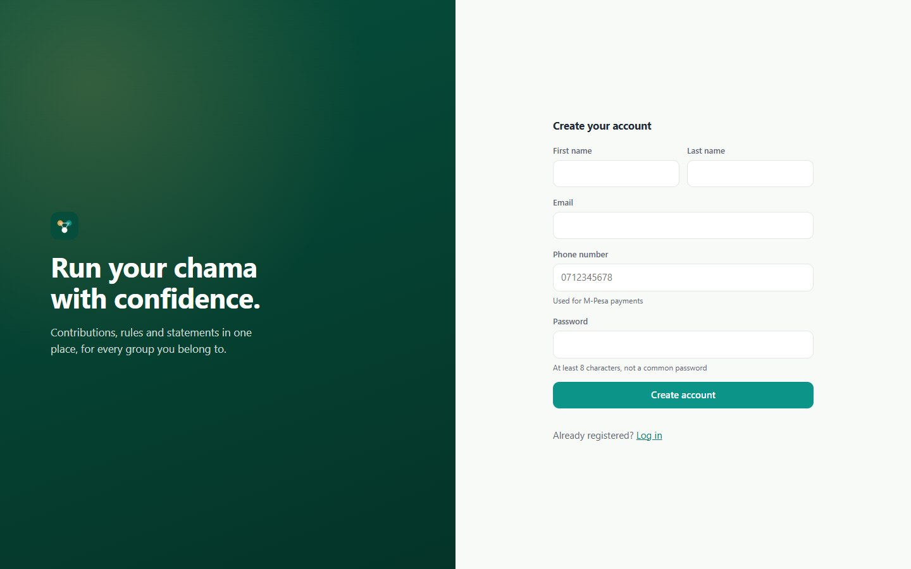

*Figure 2: Create an account*

## 2. My chamas

A user can belong to several chamas, each with its own rules, money and role.

### Your chamas

The landing page lists every chama the user belongs to, with its type, description and the user's role in it. From here a user can look for a public chama to join or start a new one.

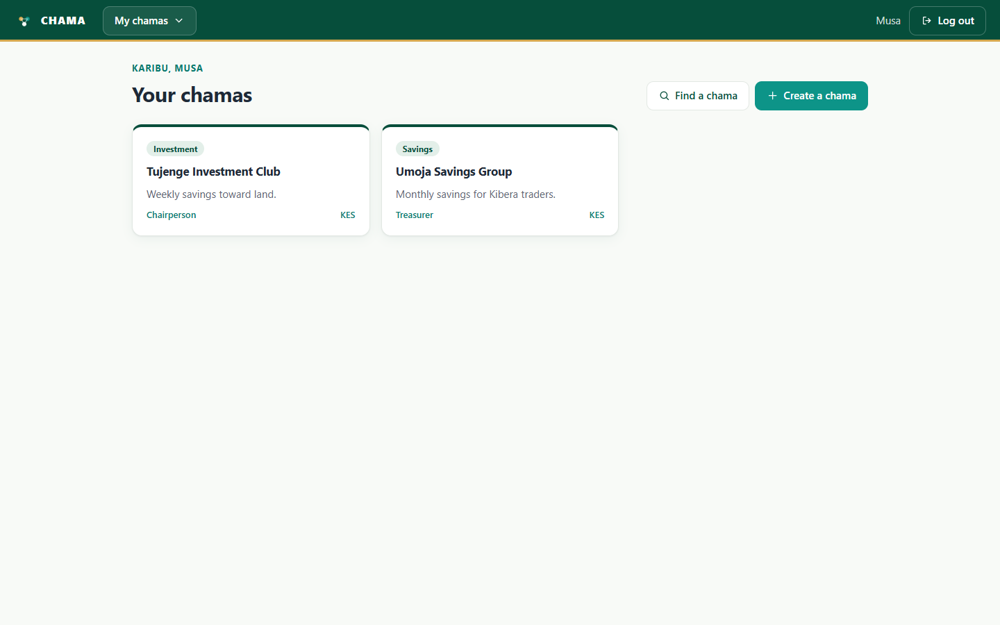

*Figure 3: Your chamas*

### Create a chama

Starting a chama is a four-step form: about the group, membership rules, contribution rules, and a review before it is created. The person who creates it becomes its chairperson.

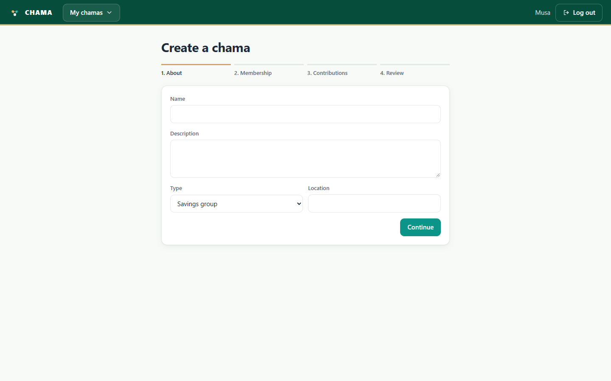

*Figure 4: Create a chama*

## 3. Umoja Savings Group (treasurer view)

As treasurer, Musa can record contributions and see the group's finances, but he cannot change members, settings or read the audit log.

### Overview

The member's own position is at the top: savings so far, what is owed now and the next contribution due. Below it, the group's books show active members, how many are overdue, and the balance of each account in the double-entry ledger.

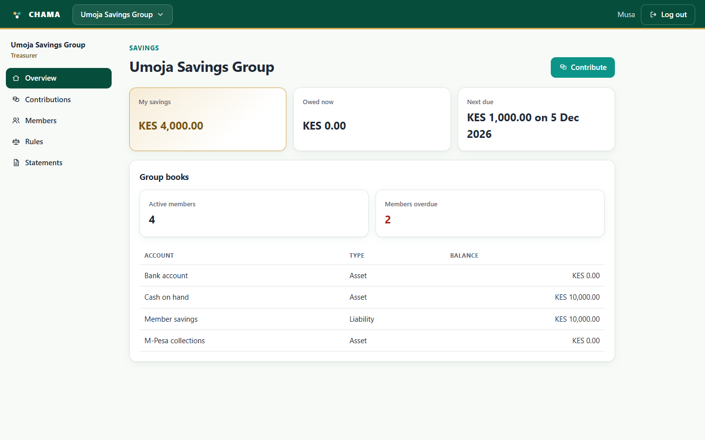

*Figure 5: Overview*

### Contributions

A member pays by M-Pesa from here: the app sends an STK Push prompt to their phone, and the payment only counts once M-Pesa confirms it. Officers can also record cash or bank deposits, generate contribution schedules and reconcile M-Pesa payments. The schedule shows each contribution due, what was paid and the version of the rule that set it.

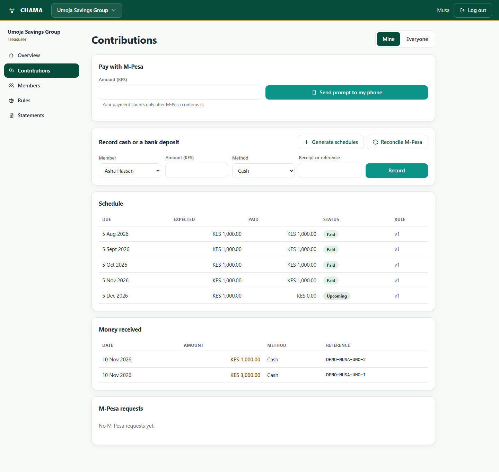

*Figure 6: Contributions*

### M-Pesa prompt (simulated)

In simulated mode the app shows the prompt the member's phone would show. Choosing Enter PIN stands in for the member approving the payment on their phone; Cancel stands in for them declining it.

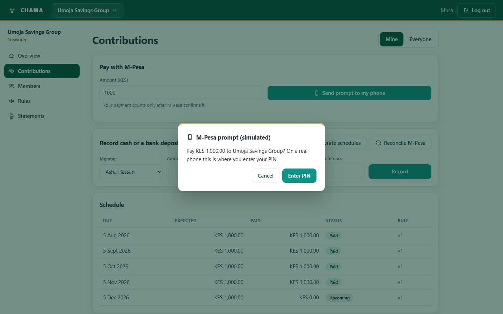

*Figure 7: M-Pesa prompt (simulated)*

### Contribution received

Once the callback confirms the payment, the member sees a confirmation, the money appears under Money received with its M-Pesa receipt, and the request is listed as Confirmed under M-Pesa requests.

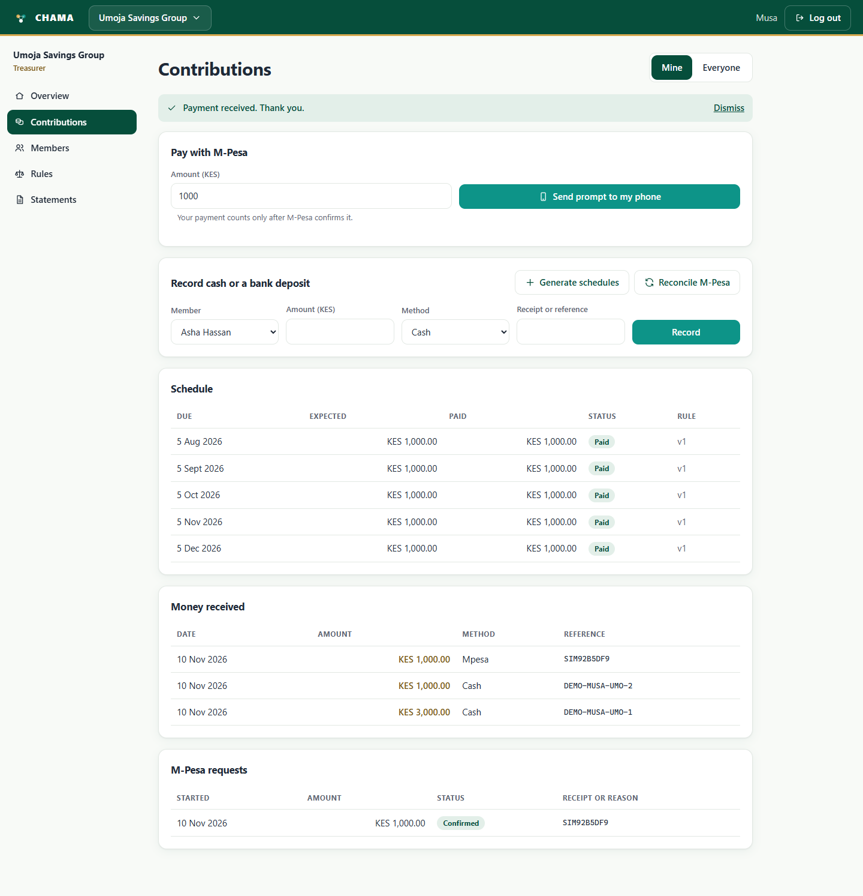

*Figure 8: Contribution received*

### Statements

Members download their own statement, with every confirmed payment, a running balance and their contribution schedule, as a PDF or an Excel file. Officers can also download the group's financial statement. Every download is recorded in the audit log.

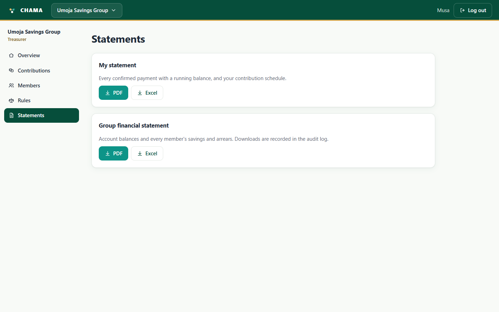

*Figure 9: Statements*

## 4. Tujenge Investment Club (chairperson view)

As chairperson, Musa also sees the Audit log and Settings pages, and can manage members and approve rule changes.

### Overview

The same overview for a weekly investment club. The navigation now includes Audit log and Settings, which only roles with those permissions see.

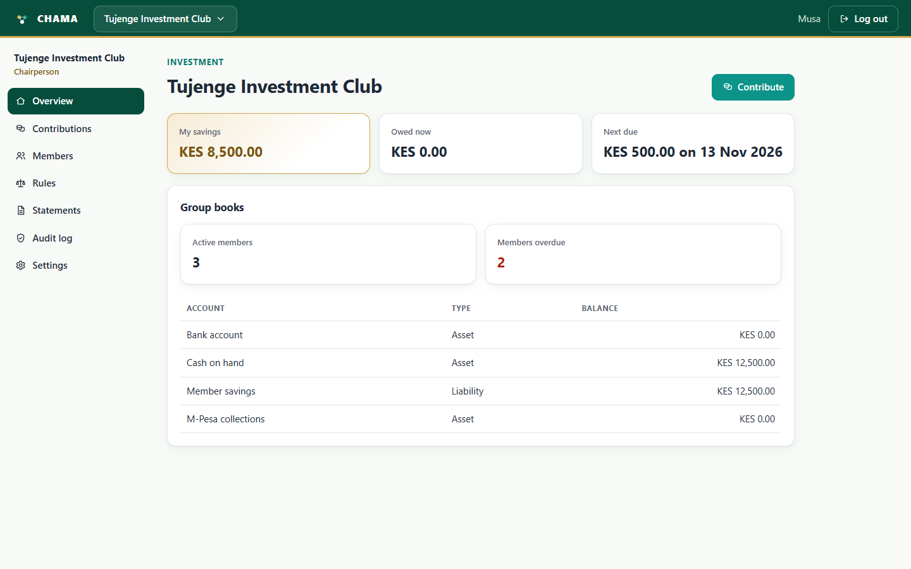

*Figure 10: Overview*

### Members

The chairperson invites people by email or phone number, changes their role, and suspends or removes members. The table at the bottom shows exactly what each role is allowed to do.

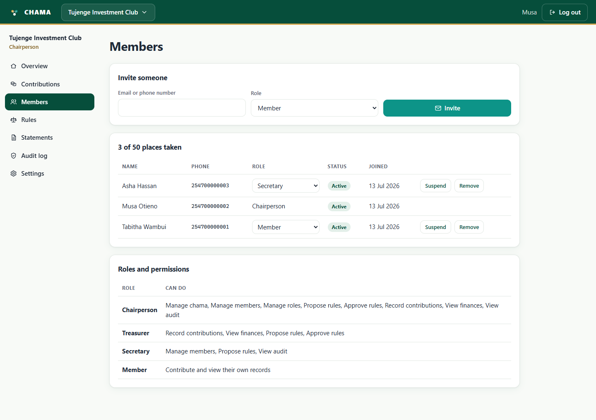

*Figure 11: Members*

### Rules and constitution

The rules in force for contributions, membership and withdrawals. A rule change is proposed and then approved, and starts on its own date: earlier contributions keep the version of the rule that applied to them. The history shows every version, who proposed it and who decided it.

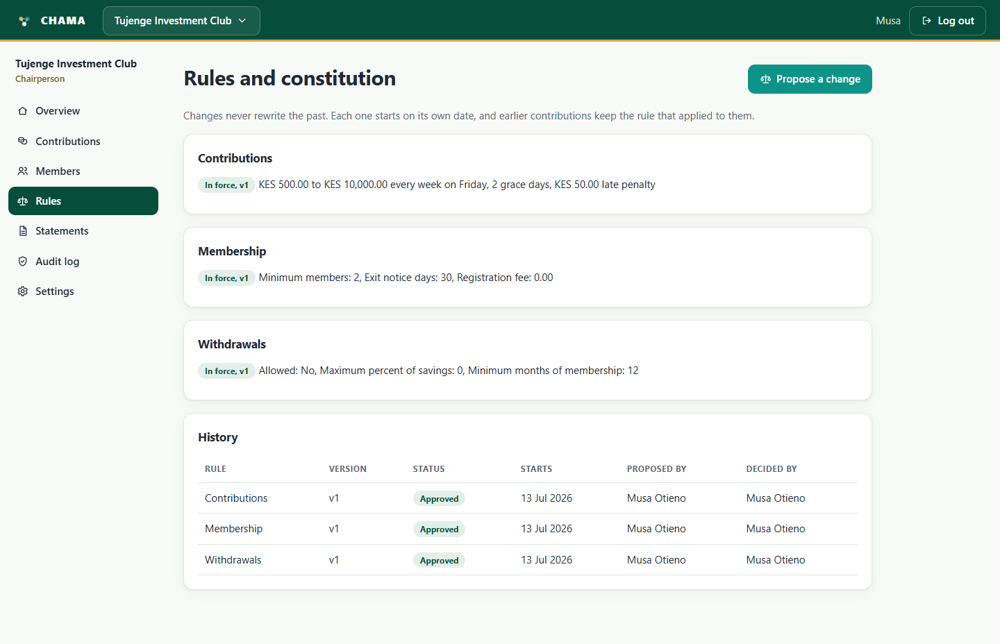

*Figure 12: Rules and constitution*

### Audit log

Every important action, who did it and when, such as contributions recorded and the chama being created. Entries cannot be changed or deleted.

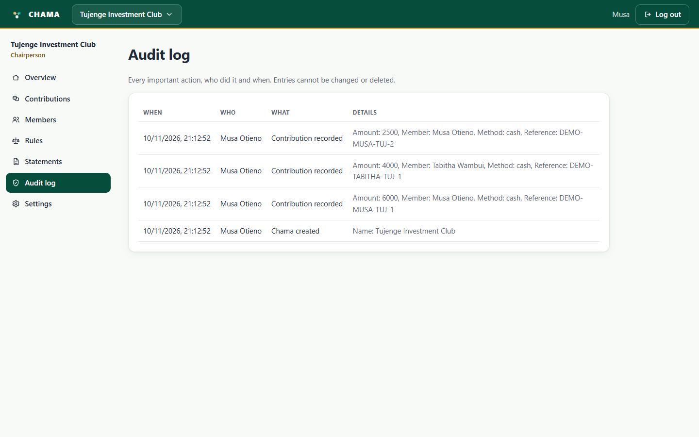

*Figure 13: Audit log*

### Settings

The chairperson changes the chama's name and description, whether it is private or public, how people join, and whether new members need approval.

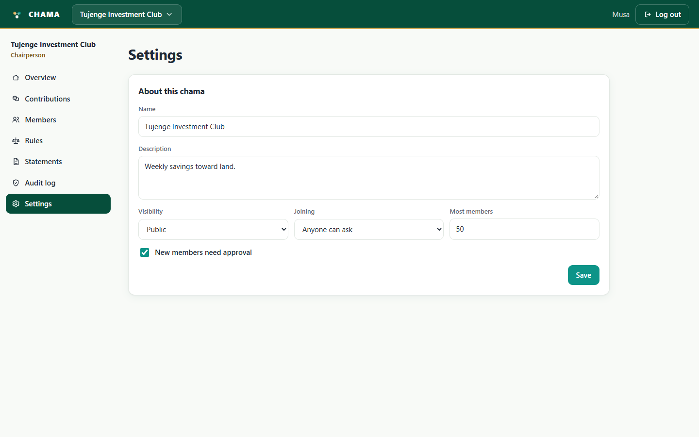

*Figure 14: Settings*
